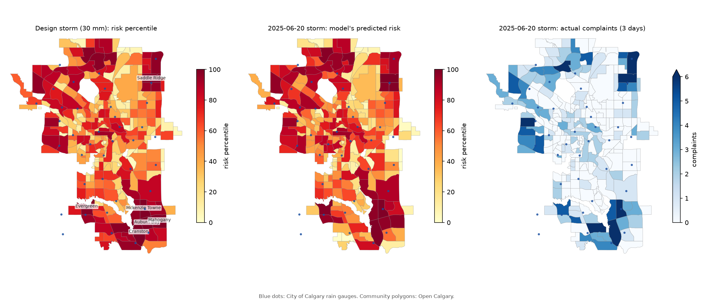
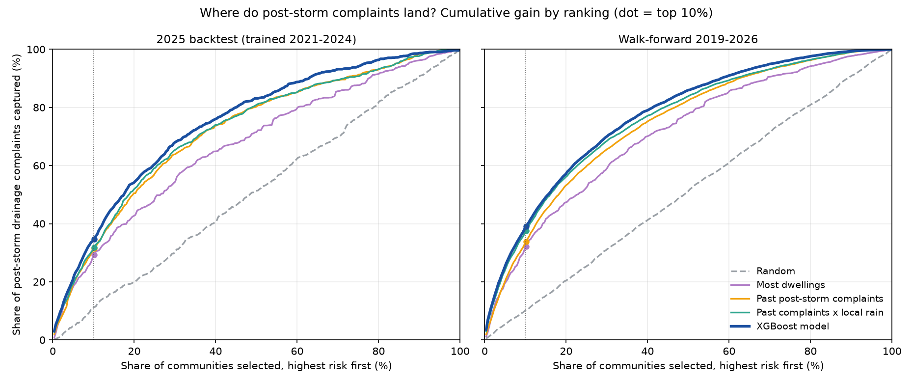

# Stormwater Intelligence (PoC)

**Which Calgary communities will report drainage problems after the next storm?**

A proof of concept that ranks communities by post-storm 311 drainage-complaint risk, using the City's own
rain-gauge network, 311 history and community characteristics. Everything comes from open data and rebuilds end to
end with two commands.



## Result

The metric: *if you could only watch the top 10 % of communities (27 of 266), ranked by risk, what share of the
drainage complaints that follow a storm would you cover?*

| Ranking | 2025 backtest (trained 2021-24; 12 storms, 1,434 complaints) | Walk-forward 2019-2026 (111 storms, 8,407 complaints) |
|---------|:---:|:---:|
| Random | 10.2 % | 10.2 % |
| Communities with the most homes | 29.3 % | 32.1 % |
| Local rainfall only | 17.0 % | 20.9 % |
| Past post-storm complaints | 31.6 % | 33.8 % |
| Past complaints x local rainfall | 31.9 % | 37.6 % |
| **XGBoost model** | **34.7 %** (95 % CI 27-40) | **39.1 %** (95 % CI 37-41) |

* The model covers **3.4x (2025) to 3.9x (2019-2026)** what random picking covers.
* Against the best simple baseline (past complaints x local rainfall) it adds **+2.8 points in 2025** (paired 95 % CI
  +0.6 to +4.4) and **+1.6 points over 2019-2026** (+0.4 to +2.6). That is real but modest: most of the signal is that
  complaints keep coming from the same communities (rank correlation 0.66-0.78 between one year and the previous four).
* On the 13 storms of 2026 (forward test, gauge season to Sep 30): 41.8 % (CI 32-49) vs 10.2 % random.
* Capture is higher for severe storms: 33.9 %, 38.4 % and 40.6 % as the peak gauge rainfall goes from below 20 mm to
  20-30 mm to above 30 mm.



### What carries the signal?

XGBoost with different feature groups, walk-forward 2019-2026, same top-10 % metric:

| Features | Top-10 % capture |
|----------|:---:|
| rain + storm descriptors only | 20.7 % |
| terrain only (30 m DEM) | 32.9 % |
| community static only (size, housing mix, age class, location) | 35.4 % |
| complaint history only | 34.7 % |
| history + rain | 39.0 % |
| history + rain + static | 38.8 % |
| everything, including terrain | 39.1 % |

* Local rainfall adds about 4 points on top of history: it is the only input that tells the model where *this* storm
  actually hit.
* Terrain from a 30 m surface model reaches 33 % on its own but adds nothing measurable on top of the rest
  (38.8 % to 39.1 %): it mostly says where in the city a community sits and how old it is. It cannot see where
  water actually collects. That needs the 2 m LiDAR DEM and the storm-sewer network (see
  [docs/MANUAL_DATA.md](docs/MANUAL_DATA.md)).
* Robustness: a 2-8 year training window moves the walk-forward result between 39.1 % and 39.9 %.

### Does the answer depend on what counts as a "drainage complaint"?

| Target (311 groups) | Complaints in the 2019-26 test storms | Past complaints x rain, 2025 / 2019-26 | XGBoost, 2025 / 2019-26 |
|---------------------|:---:|:---:|:---:|
| Catch basin only | 8,011 | 32.5 % / 38.5 % | 36.6 % / 39.7 % |
| Catch basin + drainage concerns (primary) | 8,407 | 31.9 % / 37.6 % | 34.7 % / 39.1 % |
| All rain-sensitive groups (+ storm pond, manhole, drainage bylaw) | 10,613 | 30.8 % / 35.0 % | 33.7 % / 36.6 % |

The model beats the best baseline under all three definitions (by 1.2 to 4.1 points); a broader, noisier target
lowers every number.

### What does the design-storm ranking look like?

`outputs/risk_ranking_design_storm_30mm.csv` ranks all 266 communities for a uniform 30 mm storm in mid-July, using the
history available today. It is ranked by **expected complaints**, so large new suburbs lead simply because they have
many homes; the same file has `expected_per_1000_dwellings` for the intensity view.

| # | Community | Sector | Expected complaints in the 3-day window | Dwellings (2019) |
|--:|-----------|--------|:---:|--:|
| 1 | Cranston | SE | 4.4 | 7,141 |
| 2 | Auburn Bay | SE | 3.4 | 6,046 |
| 3 | McKenzie Towne | SE | 3.3 | 7,166 |
| 4 | Mahogany | SE | 3.1 | 4,507 |
| 5 | Saddle Ridge | NE | 3.0 | 6,266 |
| 6 | Evergreen | S | 2.9 | 7,256 |
| 7 | Evanston | N | 2.8 | 5,686 |
| 8 | Panorama Hills | N | 2.7 | 8,199 |
| 9 | Chaparral | S | 2.7 | 4,179 |
| 10 | Coventry Hills | N | 2.5 | 5,595 |

The whole city is expected to file about 161 complaints in this scenario. This is a hypothetical (a uniform 30 mm over
the entire city is harsher than most real storms), and it measures complaint counts, not flood risk.

## What the data showed

* **Catch-basin requests are the rain signal.** Per day inside storm windows vs other rain-season days: catch basin
  5.2x, manhole 1.8x, drainage bylaw 1.5x, drainage concerns 1.2x, **sewer maintenance 1.0x**. The target is
  catch basin + drainage concerns; sewer backups do not show up as a storm response in 311.
* **The response is fast**: day 0 is 7.3x the quiet baseline, day 1 is 6.6x, day 2 is 3.8x. Windows are 3 days.
* **Severity matters**: complaints per storm rise with peak gauge rainfall (`outputs/figures/dose_response.png`).
* **The City gauges are trustworthy**: the gauge nearest the airport matches the Environment Canada record at
  r = 0.93 over 2,185 season days.
* **311 geography is the community centrepoint** (99.6 % of the catch-basin and drainage requests), so community
  level is the finest resolution open data allows.

Evidence tables and data quirks: [docs/DATA_SOURCES.md](docs/DATA_SOURCES.md).

## How it works

```
311 requests ──────┐
City rain gauges ──┼─► storm events ─► event x community panel ─► XGBoost (Poisson) ─► ranking + map
census, 30 m DEM ──┘   (3-day windows)  (rain, history, static)     walk-forward backtest
```

1. **Storm events.** A storm day has at least 2 gauges with 10 mm or more. The first storm day not inside an earlier
   window opens an event covering that day plus two days. 211 events from 2012 to 2026.
2. **Rainfall per community.** 5-minute tips become daily totals and maximum 60-minute accumulations per gauge, then
   inverse-distance-weighted to each community centroid (6 nearest online gauges, plus a sharper 3-gauge variant).
   Sparse logs make dead gauges look dry, so gauge-seasons are screened, and implausible 5-minute records are clipped.
3. **Label.** Catch-basin and drainage-concern requests per community in the event window (266 residential and
   industrial communities).
4. **Features (46).** Local and antecedent rainfall, storm descriptors, complaint history strictly before the event
   (last 365 days, per-event history, recency-weighted, heavy-storm share, neighbouring communities, other 311 water
   requests), 2019 census, community class and age, 30 m terrain.
5. **Model.** XGBoost with a Poisson objective on complaint counts. What is scored is the ranking within each event.
6. **Backtest.** Walk-forward: each test year is scored by a model trained on the previous four seasons only. The
   2025 headline is the originally planned split (train 2021-24, test 2025). Intervals come from a bootstrap over
   whole storms; model comparisons use a paired bootstrap on the same storms.

Leakage guards: history is updated only after an event's row is built and response windows never overlap
(`tests/test_panel.py`, `tests/test_rainfall.py`).

## Limitations: read before quoting the numbers

1. **Rain features are the storm's realised rainfall**, i.e. a perfect-forecast assumption. Operational use needs a
   rainfall forecast or nowcast and will score lower.
2. **The feature set and the 4-year window were chosen while looking at the same 2019-2026 folds** (2025 and 2026
   included). Treat the numbers as proof-of-concept grade, not as a locked-box test.
3. **311 measures complaints, not flooding.** Reporting behaviour (population, app use) is part of the signal. The
   per-dwelling intensity column uses 2019 census dwellings, so it is stale for fast-growing suburbs and is left blank
   below 500 dwellings.
4. **Community level only**, and 2025 has just 12 storms, so intervals are wide.
5. **No storm-sewer inventory** (not open data), terrain from a 30 m surface model, rainfall interpolated from 44-45
   gauges.
6. One city, one data source, no external validation.

## Reproduce

Python 3.10 or newer.

```powershell
py -3.12 -m venv .venv
.\.venv\Scripts\Activate.ps1
pip install -e ".[dev]"
stormwater-intel fetch      # a few minutes: 311, gauges, boundaries, census, ECCC, DEM into data/raw (git-ignored)
stormwater-intel run        # about 4 minutes with the ablations (--skip-ablation is faster) -> outputs/
stormwater-intel maps       # re-render the map and static figure from outputs/ in seconds
pytest                      # 40 tests, no network needed
```

## Outputs

| File | Content |
|------|---------|
| `outputs/metrics.json` | every number quoted here, plus configuration |
| `outputs/risk_map.html` | interactive map with 4 layers, no basemap tiles (GitHub does not render HTML: download and open locally) |
| `outputs/risk_ranking_design_storm_30mm.csv` | all 266 communities for a 30 mm design storm |
| `outputs/backtest_events_2025.csv`, `outputs/backtest_2025-06-20_predicted_vs_actual.csv` | per-storm 2025 results and the largest storm, predicted vs actual |
| `outputs/backtest_summary_*.csv` | model comparison tables |
| `outputs/category_rain_sensitivity.csv`, `lag_profile_catch_basin.csv`, `spatial_persistence.csv` | evidence tables |
| `outputs/figures/` | charts used here |

## Repository layout

```
src/stormwater_intel/
  fetch.py, socrata.py     download from public APIs
  data.py                  loaders and static community features
  rainfall.py              gauge QC, interpolation, storm events
  terrain.py               30 m DEM features
  panel.py                 event x community panel, leakage-free features
  model.py, metrics.py     baselines, XGBoost, walk-forward, top-k capture, bootstrap
  scenario.py              design-storm scoring
  report.py, pipeline.py, cli.py
tests/                     40 unit tests (no network)
docs/                      DATA_SOURCES.md, MANUAL_DATA.md
outputs/                   committed results
PROGRESS.md                handoff notes
```

## Data and attribution

Contains information licensed under the Open Government Licence - City of Calgary (311 requests, rain gauges,
community boundaries, census). Climate data: Environment and Climate Change Canada. Terrain: Copernicus DEM GLO-30,
produced using Copernicus WorldDEM-30 (c) DLR e.V. 2010-2014 and (c) Airbus Defence and Space GmbH 2014-2018 provided
under COPERNICUS by the European Union and ESA; all rights reserved.

Independent project. Not affiliated with or endorsed by the City of Calgary.
